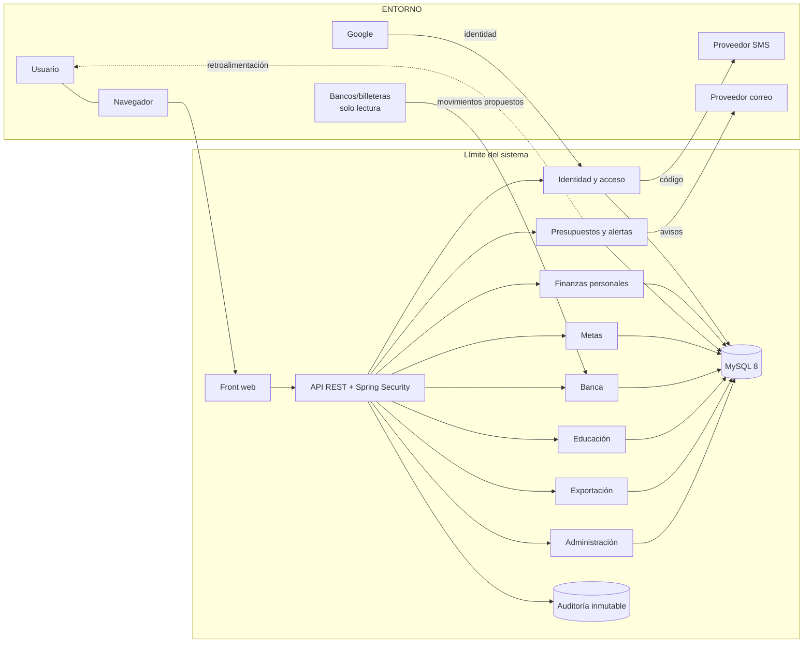

# 02 · Enfoque sistémico (TGS)

Cubre: RF-A24, RNF-01 a RNF-12 (doc 03).

## Límites del sistema
**Dentro:** sitio web, API, base de datos, motor de cálculo, alertas, auditoría, módulo Génesis.
**Fuera (entorno):** bancos y billeteras (solo lectura), Google (identidad), proveedores de SMS y correo, navegador del usuario.

## Elementos
| Elemento | Descripción |
|---|---|
| Entradas | Datos de registro, movimientos, presupuestos, metas, abonos, consentimientos, movimientos propuestos de bancos (lectura), códigos SMS |
| Procesos | Autenticación con 2FA, registro de movimientos, cálculo (uso, estado, balance, tasa de ahorro, aporte), alertas, sincronización (máx. 2/día), exportación, auditoría |
| Salidas | Resúmenes y gráficas, alertas (80 % y 100 %), exportaciones PDF/Excel, notificaciones, recomendaciones educativas |
| Retroalimentación | Alertas con acción sugerida; avance de metas; estado del presupuesto; aprobación/rechazo de propuestos que ajusta futuras propuestas; auditoría que alimenta al SUPERADMIN |
| Subsistemas | Identidad y acceso · Finanzas personales · Presupuestos y alertas · Metas · Banca · Educación · Reportes/Exportación · Administración · Auditoría · Génesis |
| Entorno | Bancos, Google, SMS, correo, normativa colombiana |

**Privacidad en el límite:** los subsistemas Administración y Génesis no tienen acceso de lectura a Finanzas personales, Metas ni Banca.
