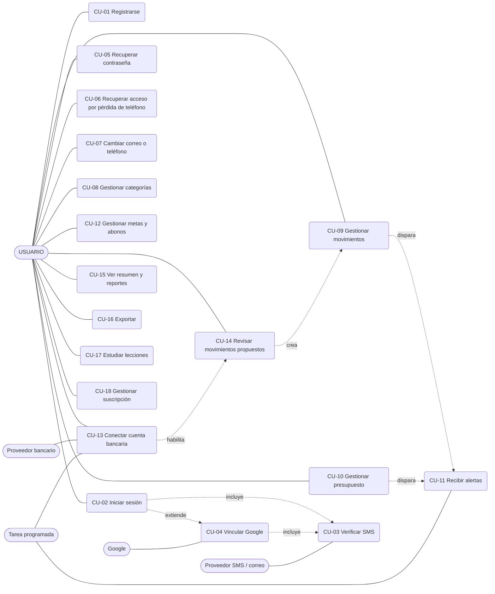
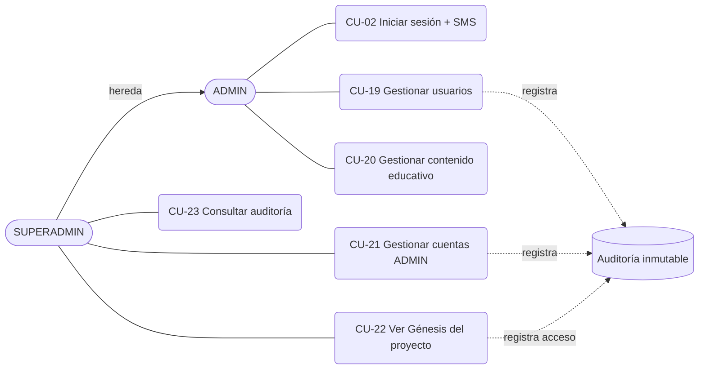
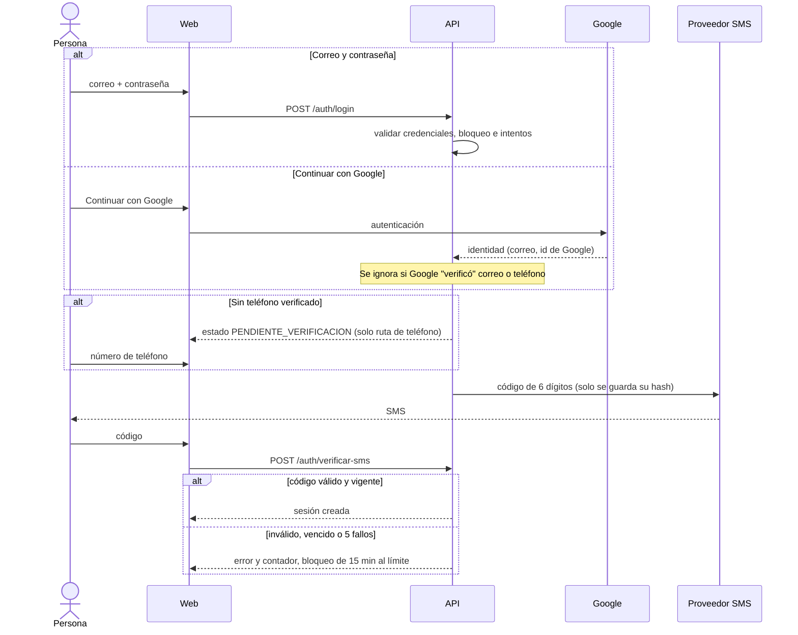

# 05 · Casos de uso

Cubre: RF-01 a RF-35, RF-A01 a RF-A05, RF-A24 a RF-A26, RN-04 a RN-17 (ver doc 03).
Los CU-01 a CU-23 son los del catálogo del doc 03. Los pasos citan las fórmulas del doc 04 (F1 a F12).

## 1. Actores y matriz de permisos (decisión D-02)

| Actor | Descripción |
|---|---|
| USUARIO | Persona mayor de 18 años con cuenta propia (plan Gratis o Pro). Solo accede a sus datos. |
| ADMIN | Personal que opera la plataforma: usuarios (solo datos de cuenta) y contenido educativo. |
| SUPERADMIN | Hereda lo de ADMIN y además gestiona cuentas ADMIN, consulta la auditoría y ve «Génesis del proyecto». |
| Proveedor SMS / correo | Sistema externo que entrega códigos y avisos. |
| Google | Sistema externo; solo prueba identidad. |
| Proveedor bancario | Sistema externo de solo lectura (simulador en desarrollo; agregador en producción). |
| Tarea programada | Actor interno: sincroniza, genera alertas, copia presupuestos recurrentes. |

| Capacidad | USUARIO | ADMIN | SUPERADMIN |
|---|:-:|:-:|:-:|
| Iniciar sesión (siempre con SMS) y gestionar su propia cuenta | Sí | Sí | Sí |
| Movimientos, categorías, presupuestos, metas, abonos propios | Sí | **No** | **No** |
| Reportes y exportaciones propios | Sí | **No** | **No** |
| Conectar bancos y revisar movimientos propuestos | Sí | **No** | **No** |
| Gestionar su suscripción | Sí | No | No |
| Leer lecciones publicadas | Sí | Sí (vista previa de todas) | Sí (vista previa de todas) |
| Crear, editar, publicar y archivar lecciones | No | Sí | Sí |
| Listar usuarios y ver **solo datos de cuenta** (nombre, correo, estado, plan, fecha de registro) | No | Sí | Sí |
| Suspender y reactivar usuarios (con motivo) | No | Sí | Sí |
| Métricas agregadas anónimas | No | Sí | Sí |
| Crear, suspender y reactivar cuentas ADMIN | No | No | Sí |
| Crear o promover SUPERADMIN desde la aplicación | No | No | **No** (alta controlada fuera de la app, supuesto S-12) |
| Consultar la auditoría | No | No | Sí |
| Ver «Génesis del proyecto» (`/superadmin/*`) | No | No | Sí |
| Ver movimientos, saldos o cuentas bancarias de **cualquier** usuario | — | **Nunca** | **Nunca** |

La matriz se aplica en el servidor en cada endpoint (RNF-03) y se prueba con pruebas negativas por rol.

## 2. Diagramas de casos de uso

## 3. Secuencia de acceso con 2FA obligatorio (CU-02, CU-03, CU-04)

No existe sesión (`sesion`) hasta que el SMS es válido (RF-06). Si el proveedor de SMS falla, no hay vía alterna (RNF-11).

## 4. Fichas

### CU-01 Registrarse
- **Actor:** persona nueva. **Requisitos:** RF-01, RF-02, RF-03, RF-15, RN-04, RN-10.
- **Precondición:** ninguna.
- **Flujo principal:** 1) ingresa nombre, correo, teléfono, fecha de nacimiento y contraseña; 2) acepta términos y tratamiento de datos; 3) el sistema valida edad ≥ 18, correo y teléfono únicos y contraseña según RN-10; 4) crea la cuenta (`PENDIENTE_VERIFICACION`) y guarda el consentimiento con versión y fecha; 5) envía enlace de verificación al correo; 6) al abrirlo, se envía SMS para verificar el teléfono (CU-03); 7) la cuenta pasa a `ACTIVO`, vacía.
- **Alternos:** registro con Google → CU-04.
- **Excepciones:** menor de edad; correo o teléfono repetidos; contraseña débil o común; sin consentimiento (no se crea nada); enlace vencido o ya usado.
- **Postcondición:** cuenta activa sin categorías, movimientos, presupuestos ni metas; la persona ve estados vacíos guiados.

### CU-02 Iniciar sesión
- **Actores:** USUARIO, ADMIN, SUPERADMIN. **Requisitos:** RF-04, RF-05, RF-A01, RNF-03.
- **Precondición:** cuenta existente y no suspendida.
- **Flujo principal:** 1) correo y contraseña (o Google, CU-04); 2) el sistema valida y registra el intento; 3) siempre ejecuta CU-03; 4) con SMS válido crea la sesión (la vigencia e inactividad máxima son un supuesto a confirmar, S-13) y redirige según rol.
- **Alternos:** cuenta `PENDIENTE_VERIFICACION` → solo la pantalla de teléfono.
- **Excepciones:** credenciales inválidas (mensaje genérico, sin decir qué falló); cuenta suspendida; bloqueo temporal tras fallos (F11).
- **Postcondición:** sesión activa; intento registrado en `intento_acceso`.

### CU-03 Verificar SMS
- **Actores:** todos; proveedor SMS. **Requisitos:** RF-06, RF-07, RF-08, RN-11, RNF-11, RNF-15.
- **Flujo principal:** 1) el sistema genera código de 6 dígitos con generador criptográfico y guarda solo su hash; 2) lo envía por SMS; 3) la persona lo ingresa; 4) si es válido y vigente (5 min) se marca usado.
- **Alternos:** reenvío tras 60 s (máx. 5 por hora).
- **Excepciones:** código incorrecto (hasta 5 intentos por código); código vencido; bloqueo de 15 min con aviso por correo; **fallo del proveedor** → mensaje «No pudimos enviar el código; intenta de nuevo en unos minutos», sin vía alterna, queda en `intento_acceso`.
- **Postcondición:** código invalidado; el 2FA no se puede desactivar (RF-08).

### CU-04 Vincular Google / entrar con Google
- **Actores:** USUARIO, ADMIN, SUPERADMIN; Google. **Requisitos:** RF-05, RF-07, RF-09, INC-09.
- **Flujo principal:** 1) la persona elige Google; 2) Google devuelve su identidad; 3) si el correo coincide con una cuenta, se pide contraseña para **vincular** y SMS (RF-09); 4) si no existe cuenta, se crea en `PENDIENTE_VERIFICACION` y se pide y verifica teléfono (RF-07); 5) en todos los ingresos posteriores se exige SMS.
- **Excepciones:** correo de Google ya ligado a otra cuenta; contraseña incorrecta al vincular; SMS fallido.
- **Postcondición:** cuenta con identidad de Google ligada; evento en `auditoria`.

### CU-05 Recuperar contraseña
- **Requisitos:** RF-10, RN-10.
- **Flujo principal:** 1) solicita con su correo; 2) respuesta siempre igual exista o no la cuenta; 3) recibe enlace de un solo uso con vigencia corta; 4) define nueva contraseña (RN-10); 5) se cierran todas las sesiones; 6) el siguiente ingreso exige SMS.
- **Excepciones:** enlace vencido o reutilizado; contraseña no válida.
- **Postcondición:** hash nuevo guardado; sesiones previas cerradas; evento auditado.

### CU-06 Recuperar acceso por pérdida del teléfono
- **Requisitos:** RF-11, PA-03.
- **Precondición:** la persona no puede recibir SMS en su número.
- **Flujo principal:** 1) inicia el trámite con correo y contraseña; 2) confirma un enlace al correo verificado; 3) el sistema aplica la verificación de identidad definida por el cliente (PA-03) y una **espera de seguridad**; 4) avisa al correo y al teléfono anterior; 5) la persona registra y verifica el nuevo número (CU-07).
- **Excepciones:** no supera la verificación (cuenta sigue protegida); la espera no ha terminado.
- **Postcondición:** teléfono reemplazado; auditoría completa. *Hasta definir PA-03 este flujo no se activa en producción.*

### CU-07 Cambiar correo o teléfono
- **Requisitos:** RF-12, RF-13, RF-14, RN-15.
- **Flujo principal:** 1) pide la contraseña; 2) ingresa el dato nuevo; 3) recibe y confirma un código en el **dato nuevo**; 4) el sistema avisa al dato **anterior**; 5) actualiza y registra en auditoría.
- **Excepciones:** falta cualquiera de los cuatro pasos (no se cambia); dato ya usado por otra cuenta; intento de cambiar la fecha de nacimiento (403).
- **Postcondición:** dato cambiado; sesiones de otros dispositivos cerradas.

### CU-08 Gestionar categorías
- **Requisitos:** RF-16, RN-09 (RF-15 como precondición).
- **Precondición:** sesión de USUARIO. La cuenta nace **sin** categorías; el formulario de movimiento permite crear la primera en línea (INC-12).
- **Flujo principal:** 1) crea, renombra o elimina una categoría de INGRESO o GASTO; 2) si la elimina y tiene movimientos, el sistema exige reasignarlos a otra categoría del mismo tipo o a «Sin categoría» (categoría del sistema, no seleccionable para nuevos movimientos); 3) si tenía presupuestos, se eliminan.
- **Excepciones:** nombre repetido para el mismo tipo; intento de editar la categoría del sistema.
- **Postcondición:** totales intactos (F1 a F4).

### CU-09 Gestionar movimientos
- **Requisitos:** RF-17, RF-18, RN-05.
- **Precondición:** al menos una categoría del tipo del movimiento.
- **Flujo principal:** 1) elige tipo, categoría, monto, fecha/hora y descripción; 2) el sistema valida (monto > 0, entero en pesos, fecha ≤ hoy, descripción no vacía); 3) avisa posibles duplicados (F12); 4) guarda; 5) recalcula uso, estado, balance y tasa; 6) dispara CU-11.
- **Alternos:** editar, cambiar de categoría, eliminar (muestra cómo cambia el % antes de confirmar, F1).
- **Excepciones:** monto ≤ 0; categoría ausente; fecha futura.
- **Postcondición:** derivados actualizados; el tipo del movimiento es el de su categoría.

### CU-10 Gestionar presupuesto
- **Requisitos:** RF-19, RF-20, RN-02, RN-07.
- **Flujo principal:** 1) elige una categoría de GASTO y el mes; 2) define límite (≥ 0) y umbrales (por defecto 80 y 100); 3) activa o no «repetir cada mes» (la tarea programada copia el presupuesto al mes siguiente); 4) ve gastado, % y estado (F1, F2).
- **Excepciones:** presupuesto repetido para categoría y mes; umbrales inválidos (`1 ≤ a < p ≤ 100`).
- **Postcondición:** presupuesto guardado; no existe monto total almacenado (el total es la suma de límites).

### CU-11 Recibir alertas
- **Actores:** tarea programada, USUARIO. **Requisitos:** RF-20, RF-21, RF-35, RN-17.
- **Disparador:** cualquier cambio en movimientos o presupuestos.
- **Flujo principal:** 1) se evalúa F2; 2) si cruza un umbral y no hay alerta previa para ese presupuesto, mes y umbral, crea una `notificacion` con **acción sugerida**; 3) la entrega en la app y por correo.
- **Excepciones:** alertas desactivadas en el presupuesto; falla del correo (queda en la app).
- **Postcondición:** una sola alerta por umbral, categoría y mes.

### CU-12 Gestionar metas y abonos
- **Requisitos:** RF-22, RF-23, RF-24, RN-03, RN-13, RN-14.
- **Flujo principal:** 1) crea meta con nombre, objetivo (> 0) y fecha futura; 2) ve aporte mensual sugerido y progreso (F5 a F7); 3) registra abonos (> 0); 4) al llegar a `S ≥ O` se muestra «cumplida».
- **Excepciones:** fecha vencida (sin aporte); abono ≤ 0.
- **Postcondición:** los abonos **no** modifican el balance (supuesto S-07, PA-08).

### CU-13 Conectar cuenta bancaria
- **Actores:** USUARIO, proveedor bancario, tarea programada. **Requisitos:** RF-28, RF-29, RF-34, RN-06, RNF-10.
- **Flujo principal:** 1) el sistema muestra los permisos (solo lectura, 90 días, vence, revocable, sin guardar credenciales); 2) la persona autoriza ante el proveedor; 3) se guarda la cuenta con últimos 4 dígitos y el consentimiento; 4) la tarea programada sincroniza como máximo 2 veces al día (F9) y crea **movimientos propuestos**; 5) una sola notificación con el total y el detalle por banco.
- **Alternos:** revocar el permiso; reconectar si venció.
- **Excepciones:** permiso vencido; error del proveedor (cuenta en estado ERROR, no consume cupo); tercera sincronización del día (rechazada). **No hay sincronización manual.**
- **Postcondición:** ningún dato propuesto afecta cálculos todavía.

### CU-14 Revisar movimientos propuestos
- **Requisitos:** RF-30, RF-31, RN-05.
- **Flujo principal:** 1) abre la bandeja; 2) por cada propuesto ve descripción, monto, fecha, cuenta, categoría sugerida y aviso de posible duplicado (F12); 3) corrige categoría o descripción; 4) **aprueba uno por uno** (no existe «aprobar todo») o rechaza; 5) al aprobar se crea el `movimiento` y se recalcula todo (CU-09 pasos 5-6).
- **Excepciones:** el usuario no tiene categorías (se le pide crear una); propuesto ya revisado.
- **Postcondición:** un rechazado no vuelve a proponerse (`UNIQUE(cuenta, id_externo)`); uno aprobado no se importa de nuevo.

### CU-15 Ver resumen y reportes
- **Requisitos:** RF-25, RF-26, RW-08.
- **Flujo principal:** 1) el sistema calcula al consultar balance, ingresos, gastos, tasa de ahorro y uso por categoría (F1 a F4); 2) muestra gráficos legibles desde 360 px; 3) muestra «Orientación, no asesoría financiera».
- **Alternos:** sin datos → estado vacío con acción para registrar el primer movimiento; el mes cambia según F8.
- **Postcondición:** nada se persiste (los reportes son calculados).

### CU-16 Exportar
- **Requisitos:** RF-27, RN-16.
- **Flujo principal:** 1) elige formato (PDF o Excel), tipo de reporte y periodo; 2) el sistema cuenta los movimientos (F10); 3) genera el archivo y registra la exportación.
- **Excepciones:** supera 5.000 (PDF) o 100.000 (Excel) → rechazo con sugerencia de acotar.
- **Postcondición:** registro en `exportacion`; el archivo caduca.

### CU-17 Estudiar lecciones
- **Requisitos:** RF-32, RW-08.
- **Flujo principal:** 1) ve solo lecciones **publicadas**; 2) lee y marca completada; 3) se guarda el progreso.
- **Postcondición:** `progreso_leccion` actualizado. Aviso de orientación visible.

### CU-18 Gestionar suscripción
- **Requisitos:** RF-33, PA-02.
- **Flujo principal:** 1) ve plan Gratis y Pro ($11.900 COP/mes, prueba 7 días); 2) inicia la prueba o cambia de plan; 3) el sistema habilita funciones según el plan.
- **Pendiente:** descuento anual, límites del plan Gratis y pasarela de pago (PA-02). Sin pasarela, la prueba no pide tarjeta (S-04).

### CU-19 Gestionar usuarios (ADMIN)
- **Requisitos:** RF-A02, RF-A03, RN-12.
- **Flujo principal:** 1) lista y busca usuarios con nombre, correo, plan, estado y fecha de registro; 2) suspende o reactiva indicando un **motivo**; 3) al suspender se cierran sus sesiones; 4) todo queda auditado.
- **Excepciones:** intento de ver movimientos, saldos o cuentas (no existe en la API; 403/404); intento de suspender a un ADMIN (solo SUPERADMIN).
- **Postcondición:** usuario suspendido no puede iniciar sesión.

### CU-20 Gestionar contenido educativo (ADMIN)
- **Requisitos:** RF-A04.
- **Flujo principal:** 1) crea o edita una lección (título, tema, nivel, minutos, contenido) en BORRADOR; 2) la pasa a EN_REVISION y luego a PUBLICADA; 3) puede archivarla.
- **Postcondición:** solo las PUBLICADAS llegan a los usuarios.

### CU-21 Gestionar cuentas ADMIN (SUPERADMIN)
- **Requisitos:** RF-A24.
- **Flujo principal:** 1) crea una cuenta ADMIN (correo y teléfono, se activa con CU-01/CU-03); 2) la suspende o reactiva con motivo; 3) todo auditado.
- **Excepciones:** intento de crear o promover a SUPERADMIN desde la app (rechazado, S-12).

### CU-22 Ver «Génesis del proyecto» (SUPERADMIN)
- **Requisitos:** RF-A25, RW-09.
- **Flujo principal:** 1) entra a `/superadmin/genesis` con sesión SUPERADMIN (2FA ya cumplido); 2) navega por las secciones del análisis y el diseño; 3) sigue la trazabilidad requisito → caso de uso → clase → tabla → pantalla.
- **Excepciones:** otro rol (403 desde el servidor); no solo se oculta el menú.
- **Postcondición:** solo lectura; el acceso queda en auditoría; ningún dato de usuarios se muestra.

### CU-23 Consultar auditoría (SUPERADMIN)
- **Requisitos:** RF-A26, RNF-04.
- **Flujo principal:** filtra por fecha, actor y acción y consulta registros; no puede editar ni borrar.
- **Postcondición:** el acceso a la consulta también se audita.

## 5. Trazabilidad CU → requisitos (resumen)

| CU | Requisitos |
|---|---|
| 01 | RF-01, 02, 03, 15 |
| 02 | RF-04, 05, A01 |
| 03 | RF-06, 07, 08, A01 |
| 04 | RF-05, 07, 09 |
| 05 | RF-10 |
| 06 | RF-11 |
| 07 | RF-12, 13, 14 |
| 08 | RF-16 |
| 09 | RF-17, 18 |
| 10 | RF-19 |
| 11 | RF-20, 21, 35 |
| 12 | RF-22, 23, 24 |
| 13 | RF-28, 29, 34 |
| 14 | RF-30, 31 |
| 15 | RF-25, 26 |
| 16 | RF-27 |
| 17 | RF-32 |
| 18 | RF-33 |
| 19 | RF-A02, A03, A05 |
| 20 | RF-A04 |
| 21 | RF-A24 |
| 22 | RF-A25 |
| 23 | RF-A26 |
