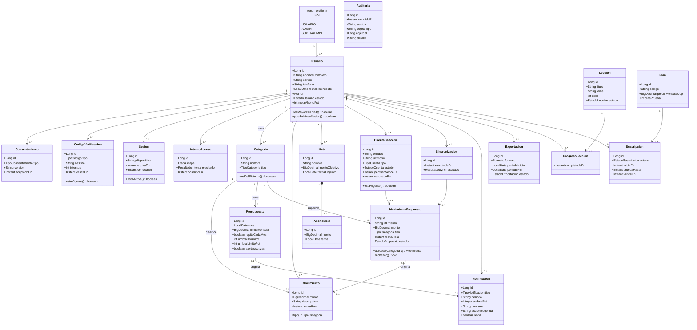
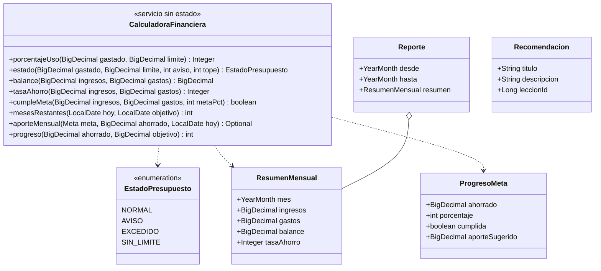
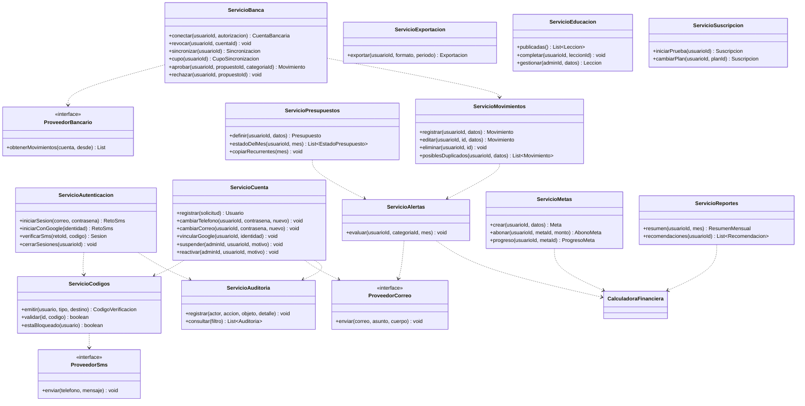
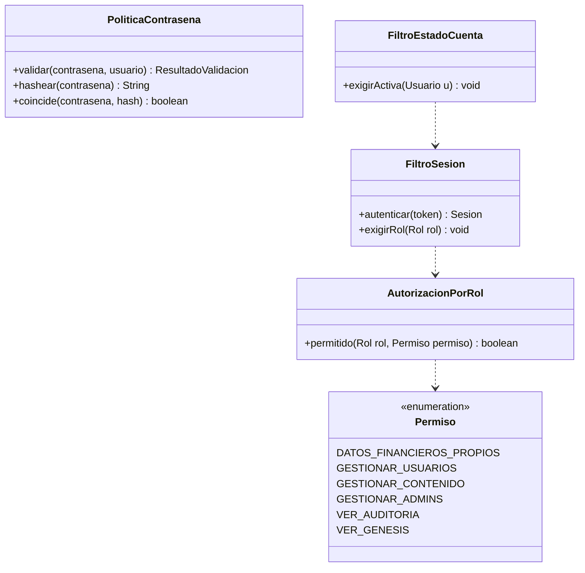

# 06 · Diagrama de clases unificado

Cubre: RF-01 a RF-35, RF-A01 a RF-A26, RN-01 a RN-17, RNF-01, RNF-03, RNF-04.
Alineado con el DER (doc 07). Convención (INC-01): clases en PascalCase y español; atributos en camelCase; tablas y columnas en snake_case. Paquete base `com.finansmart`.

## 1. Qué persiste y qué se calcula

| Persistente (entidad con tabla) | Calculado (objeto de valor, **sin tabla**) |
|---|---|
| Usuario, Rol, Consentimiento, CodigoVerificacion, Sesion, IntentoAcceso, Categoria, Movimiento, MovimientoPropuesto, CuentaBancaria, Sincronizacion, Presupuesto, Meta, AbonoMeta, Notificacion, Exportacion, Leccion, ProgresoLeccion, Auditoria, Plan, Suscripcion | EstadoPresupuesto, ResumenMensual, ProgresoMeta, Reporte, Recomendacion, CupoSincronizacion |

`Reporte` y `Recomendacion` (clases del informe 1) pasan a objetos calculados: un reporte se genera al consultar y solo `Exportacion` deja registro. Las recomendaciones salen de reglas sobre los cálculos y de las lecciones publicadas; no tienen «impacto estimado» inventado.

## 2. Dominio

*Auditoría* no tiene relaciones de clave: guarda `actorId` y `objetoId` como referencias lógicas para que el registro sobreviva a la eliminación de cuentas y sea inmutable (RNF-04).
*Reglas de integridad que no expresa el diagrama:* un movimiento y su categoría pertenecen al mismo usuario o la categoría es del sistema; un presupuesto solo apunta a categorías de GASTO del usuario; `Usuario.rol` es un solo rol.

## 3. Objetos calculados

La `CalculadoraFinanciera` implementa F1 a F8 del doc 04 con `BigDecimal` y producto cruzado. Es la única clase autorizada a decidir estados y alertas.

## 4. Servicios

`ServicioBanca.sincronizar` llama a `ProveedorBancario` y crea solo `MovimientoPropuesto` (INC-02); la única vía a `Movimiento` es `aprobar`. `ProveedorBancario`, `ProveedorSms` y `ProveedorCorreo` son interfaces para poder usar simuladores en desarrollo y pruebas, sin credenciales en el código.

## 5. Seguridad y autorización

| Rol | Permisos |
|---|---|
| USUARIO | `DATOS_FINANCIEROS_PROPIOS` |
| ADMIN | `GESTIONAR_USUARIOS`, `GESTIONAR_CONTENIDO` |
| SUPERADMIN | los de ADMIN + `GESTIONAR_ADMINS`, `VER_AUDITORIA`, `VER_GENESIS` |

**No existe** un permiso que dé a ADMIN o SUPERADMIN acceso a datos financieros de otros usuarios (RN-12). `FiltroEstadoCuenta` hace que un usuario en `PENDIENTE_VERIFICACION` solo alcance la ruta de verificación de teléfono (RF-07), y que uno suspendido reciba 401 (RF-A03).

## 6. Equivalencias con los insumos

| Informe 1 / Canva | Clase unificada | Cambio |
|---|---|---|
| Usuario (nivelEducativo, fechaRegistro) | `Usuario` | Se elimina `nivelEducativo` (dato innecesario; el avance sale de `ProgresoLeccion`); `fechaRegistro` es `creadoEn` |
| Transaccion | `Movimiento` | Tipo derivado de su categoría; origen derivado de `MovimientoPropuesto` |
| Categoria (limiteMensual) | `Categoria` | El límite pasa a `Presupuesto` por mes |
| Presupuesto (montoTotal, asignaciones) | `Presupuesto` | Una fila por categoría y mes; el total es calculado |
| Alerta | `Notificacion` | Severidad derivada del tipo |
| MetaFinanciera (ahorroMensualPlaneado) | `Meta` + `AbonoMeta` | El ahorro mensual es calculado (F5) |
| Reporte | `Reporte` calculado + `Exportacion` | Solo la exportación persiste |
| Recomendacion (impactoEstimado) | `Recomendacion` calculada | Sin cifra de impacto (D-07) |
| CuentaBancaria (numeroEnmascarado) | `CuentaBancaria` | Solo últimos 4 dígitos |
| EducacionFinanciera | `Leccion` + `ProgresoLeccion` | Relación N:M con avance |
| SincronizacionBancaria.generarTransacciones() | `ServicioBanca.sincronizar()` | Crea propuestos, nunca movimientos (INC-02) |
| Rol SOPORTE/ANALISTA/SUPERADMIN | `Rol` USUARIO/ADMIN/SUPERADMIN | Tres niveles confirmados (D-02) |
