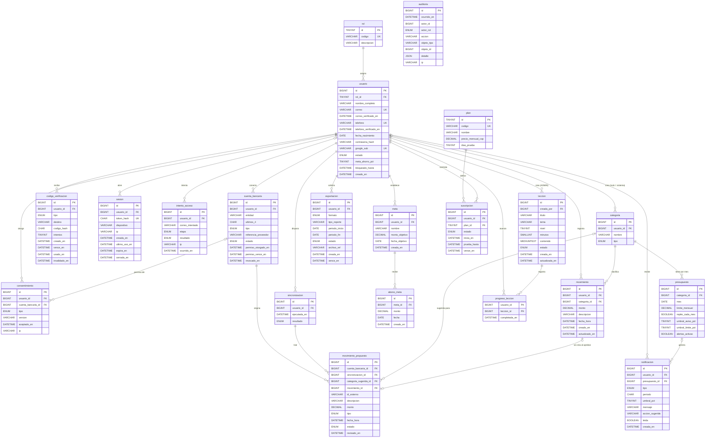

# 07 · Diagrama entidad-relación (DER)

Cubre: RF-01 a RF-35, RF-A01 a RF-A26, RNF-04, RNF-05, RNF-13. Resuelve INC-01, INC-03, INC-12, INC-13.
Notación: Chen es la del borrador de Canva; aquí se usa **notación de «pata de gallo»** (`||` uno exacto, `|o` cero o uno, `o{` cero o muchos, `|{` uno o muchos), que expresa mejor claves y cardinalidades. PK = clave primaria, FK = clave foránea, UK = única.

## 1. Diagrama

`auditoria` no tiene claves foráneas a propósito: sus referencias (`actor_id`, `objeto_id`) son lógicas para que el registro inmutable sobreviva a la eliminación de cuentas (RNF-04, PA-10).

## 2. Cardinalidades y reglas que el diagrama no dibuja

| Regla | Dónde se aplica |
|---|---|
| Un usuario tiene **un** rol | `usuario.rol_id` obligatorio |
| `categoria.usuario_id` nulo ⇒ categoría del sistema («Sin categoría», una de INGRESO y otra de GASTO); no existe columna `es_sistema` (3FN) | Se deduce de `usuario_id IS NULL`; el script semilla crea solo esas dos |
| Nombre de categoría único por usuario y tipo | `UNIQUE (usuario_id, tipo, nombre)` |
| Un presupuesto por categoría y mes | `UNIQUE (categoria_id, mes)`; `mes` es siempre el día 1 |
| Presupuesto solo sobre categorías de GASTO de un usuario | Servicio + pruebas (la BD no cruza tablas en `CHECK`) |
| Un movimiento nace de a lo sumo un propuesto | `UNIQUE (movimiento_id)` en `movimiento_propuesto` |
| Un rechazado o importado no vuelve a proponerse (RF-31) | `UNIQUE (cuenta_bancaria_id, id_externo)` |
| Una alerta por umbral, categoría y mes (RN-17) | `UNIQUE (presupuesto_id, periodo, tipo)` en `notificacion` |
| Un solo progreso por usuario y lección | PK compuesta de `progreso_leccion` |
| Montos en pesos enteros y positivos | `CHECK (monto > 0 AND monto = TRUNCATE(monto, 0))` |
| `1 ≤ umbral_aviso_pct < umbral_limite_pct ≤ 100` | `CHECK` en `presupuesto` |
| `meta_ahorro_pct` entre 1 y 100 | `CHECK` en `usuario` |
| Auditoría solo inserción | Usuario de BD de la aplicación sin `UPDATE` ni `DELETE` |
| Un solo teléfono y correo por cuenta | `UNIQUE` en `usuario` |
| `APROBADO` ⇔ tiene `movimiento_id` | `CHECK ((estado = 'APROBADO') = (movimiento_id IS NOT NULL))` |
| Solo el permiso bancario apunta a una cuenta | `CHECK ((tipo = 'PERMISO_BANCARIO') = (cuenta_bancaria_id IS NOT NULL))` |
| `codigo_verificacion.destino` solo en cambios de correo o teléfono | Nulo en los demás tipos (el canal se deduce del tipo, 3FN) |

## 3. Catálogos semilla (no son datos de ejemplo)

El script de base de datos incluirá únicamente lo que el sistema necesita para funcionar; esto **no contradice** «la cuenta nace vacía» (INC-12), porque no pertenece a ningún usuario:
- `rol`: USUARIO, ADMIN, SUPERADMIN.
- `plan`: GRATIS y PRO ($11.900 COP/mes, 7 días de prueba, decisión D-03). Los límites del plan Gratis quedan pendientes (PA-02).
- `categoria` del sistema: «Sin categoría» (INGRESO y GASTO). Solo sirve de destino al reasignar (RN-09); no se ofrece al crear un movimiento.
No se precargan categorías, movimientos, presupuestos, metas, lecciones ni usuarios.

## 4. Valores de las columnas `ENUM`

| Columna | Valores |
|---|---|
| `usuario.estado` | PENDIENTE_VERIFICACION, ACTIVO, SUSPENDIDO |
| `consentimiento.tipo` | TERMINOS, TRATAMIENTO_DATOS, PERMISO_BANCARIO |
| `codigo_verificacion.tipo` | ACCESO_SMS, VERIFICAR_TELEFONO, VERIFICAR_CORREO, CAMBIO_TELEFONO, CAMBIO_CORREO, RECUPERAR_CONTRASENA, RECUPERAR_TELEFONO, VINCULAR_GOOGLE |
| `intento_acceso.etapa` | CONTRASENA, GOOGLE, SMS |
| `intento_acceso.resultado` | EXITOSO, CREDENCIALES_INVALIDAS, CODIGO_INCORRECTO, CODIGO_VENCIDO, BLOQUEADO, SMS_NO_ENVIADO |
| `categoria.tipo` | INGRESO, GASTO |
| `cuenta_bancaria.tipo` | AHORROS, CORRIENTE, BILLETERA |
| `cuenta_bancaria.estado` | ACTIVA, ERROR (revocada = `revocado_en` no nulo; vencida = `permiso_vence_en` pasado) |
| `sincronizacion.resultado` | EXITOSA, PARCIAL, FALLIDA |
| `movimiento_propuesto.tipo` | INGRESO, GASTO |
| `movimiento_propuesto.estado` | PENDIENTE, APROBADO, RECHAZADO |
| `notificacion.tipo` | ALERTA_AVISO, ALERTA_LIMITE, SINCRONIZACION, META_CUMPLIDA, SEGURIDAD, SISTEMA |
| `exportacion.formato` | PDF, EXCEL |
| `exportacion.estado` | LISTA, RECHAZADA (vencida = `vence_en` pasado) |
| `leccion.estado` | BORRADOR, EN_REVISION, PUBLICADA, ARCHIVADA |
| `suscripcion.estado` | PRUEBA, ACTIVA, CANCELADA, VENCIDA |
| `auditoria.actor_rol` | USUARIO, ADMIN, SUPERADMIN, SISTEMA |

## 5. Diferencias frente al DER de Canva (INC-03)

El borrador de Canva tiene 10 entidades. Se leyó de la imagen exportada; algunas etiquetas pequeñas pueden tener errores de lectura.

| Canva | Atributos en Canva | Decisión en el DER nuevo | Justificación |
|---|---|---|---|
| Usuario | id, nombre, email, teléfono, nivelEducativo, fechaRegistro, estado | `usuario` con rol, verificación de correo y teléfono, fecha de nacimiento, hash de contraseña, `google_sub`, meta de ahorro, bloqueo. Se **elimina** `nivelEducativo` | RN-04 exige fecha de nacimiento; el 2FA exige teléfono verificado; el nivel educativo es un dato personal innecesario (Ley 1581 de 2012, minimización) y su avance real sale de `progreso_leccion` |
| (no existe) | — | `rol` | D-02: tres niveles |
| Presupuesto | id, periodo, montoTotal, asignaciones | `presupuesto` por **categoría y mes** con límite, umbrales y recurrencia | `asignaciones` era un atributo multivalor (rompe 1FN) y `montoTotal` es derivable (suma de límites) |
| Categoria | id, nombre, tipo, limiteMensual | `categoria` con dueño opcional (`usuario_id`; nulo = del sistema); el límite se va a `presupuesto` | `limiteMensual` duplicaba el presupuesto y no admite histórico por mes (INC-13) |
| Transaccion | id, tipo, monto, fecha, descripción, origen | `movimiento` sin `tipo` ni `origen` | El tipo lo da la categoría y el origen se deduce de `movimiento_propuesto`: guardarlos crearía contradicciones (3FN) |
| Alerta | id, tipo, mensaje, fecha, severidad | `notificacion` con periodo, umbral y acción sugerida; sin `severidad` | La severidad se deduce del `tipo`; RF-21 exige acción sugerida |
| MetaFinanciera | id, nombre, objetivo, ahorroMensualPlaneado, fechaObjetivo | `meta` + `abono_meta` | El ahorro mensual es calculado (F5); sin abonos no hay progreso (RF-23) |
| Reporte | id, rango, tipo, gráfico | **No persiste**; solo `exportacion` | Un reporte es calculado; guardar el gráfico duplicaría datos |
| Recomendacion | id, título, descripción, impactoEstimado | **No persiste**; sale de reglas y de `leccion` | `impactoEstimado` sería una cifra sin sustento (D-07) |
| CuentaBancaria | id, banco, númeroEnmascarado, tipo | `cuenta_bancaria` con últimos 4, estado, vencimiento y revocación | RF-28: permiso con vencimiento y revocable |
| EducacionFinanciera | id, título, contenido, nivel | `leccion` + `progreso_leccion` | La relación usuario–lección es N:M y debe guardar el avance (RF-32) |
| (no existe) | — | `movimiento_propuesto`, `sincronizacion` | Banca con revisión del usuario (INC-02) |
| (no existe) | — | `consentimiento`, `codigo_verificacion`, `sesion`, `intento_acceso` | 2FA, consentimiento y trazabilidad de acceso |
| (no existe) | — | `plan`, `suscripcion` | RF-33 |
| (no existe) | — | `auditoria` | RNF-04, RF-A26 |

**Relaciones de Canva:** Usuario–Presupuesto («Define»), Usuario–Alerta, Usuario–Meta, Usuario–CuentaBancaria («Posee»), Usuario–Educación («Accede a»), Usuario–Reporte («Genera»), Usuario–Recomendación («Obtiene»), Usuario–Transacción («Realiza»), Categoría–Transacción («Se clasifica en»), Categoría–Presupuesto («Asigna a») y Reporte–Transacción («Comprende»). Cambios:
- *Usuario–Presupuesto* ahora pasa por la categoría (`categoria → presupuesto`), porque el límite es por categoría.
- *Usuario–Reporte*, *Usuario–Recomendación* y *Reporte–Transacción* **desaparecen**: son entidades calculadas.
- *Usuario–Educación* se vuelve N:M con `progreso_leccion`.
- *Categoría–Transacción* se mantiene (1:N).

Tabla de totales: Canva 10 entidades → DER nuevo **21 tablas** (el documento web hablaba de 20; la 21.ª es `plan`, que evita escribir el precio en el código y deja la decisión D-03 en un catálogo).

## 6. Hallazgos de esta fase (se agregan a la trazabilidad del doc 01)

| ID | Conflicto | Decisión |
|---|---|---|
| INC-12 | RF-15 (la cuenta nace sin categorías) frente a RF-17 (la categoría es obligatoria) y RN-09 («Sin categoría» del sistema) | La primera categoría se crea en línea desde el formulario de movimiento. «Sin categoría» es del sistema, solo para reasignar. Los catálogos semilla no son datos de ejemplo |
| INC-13 | INC-01 decía «categoria (con `limite_mensual`)» pero RF-19 pone el límite en el presupuesto | El límite vive **solo** en `presupuesto`, por categoría y mes |
| INC-14 | RF-23 no dice si un abono a una meta reduce el balance | Los abonos **no** son movimientos y no cambian el balance (supuesto S-07, PA-08) |
| INC-15 | RN-02 llama «excedido» a `G ≥ L`, que con `G = L` no es exceso | Mismo estado y color, textos distintos: «Llegaste a tu límite» / «Superaste tu límite por $X» |
